# Galería del diagnóstico Dibujo

30 entradas fijadas antes de medir; perfil **Dibujo en todos los casos**. Estructura, Medio, sensibilidad 50 y 400 componentes. Ejecución Android API 29 [39546562978](https://github.com/carlossan1993/fourier-art-android/actions/runs/39546562978).

Las comparaciones muestran original y salida real del renderizador, sin corrección de contornos. La miniatura WebP solo facilita la consulta; se enlaza el PNG íntegro. [Rúbrica y resultados](INFORME.md).

## P01 · puntuación 2

Rostro con ambos ojos, nariz y sonrisa; postura, uniforme y casco distinguibles. Ruido en insignias y fondo.

[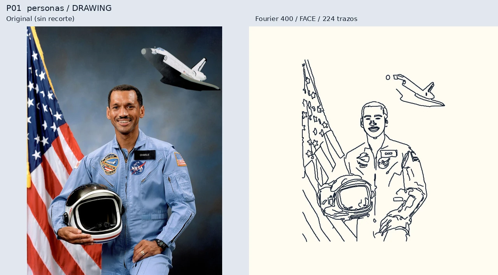](outputs-drawing/P01.png)

[Original](inputs/P01.jpg) · [PNG íntegro](outputs-drawing/P01.png) · [Fuente y licencia](https://commons.wikimedia.org/wiki/File:Charles_Bolden_astronaut_photo.jpg)

## P02 · puntuación 2

Forma del rostro, ojos, nariz, boca y cabello reconocibles; se conserva la postura frente a la maqueta. Detalle fino del pelo perdido.

[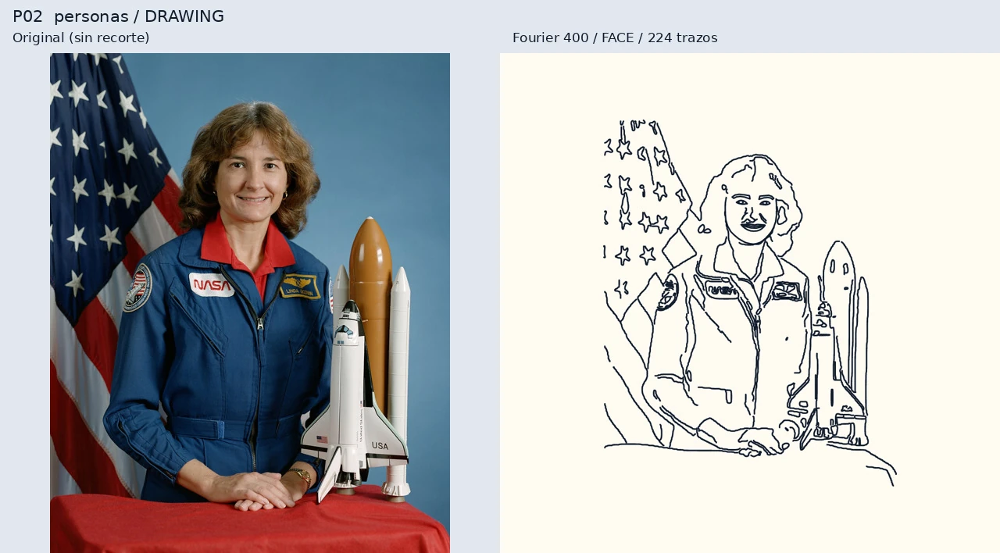](outputs-drawing/P02.png)

[Original](inputs/P02.jpg) · [PNG íntegro](outputs-drawing/P02.png) · [Fuente y licencia](https://commons.wikimedia.org/wiki/File:Official_portrait_of_astronaut_Linda_M._Godwin.jpg)

## P03 · puntuación 2

Cabeza inclinada, ojos, nariz, sonrisa y pelo corto distinguibles; manos y uniforme simplificados.

[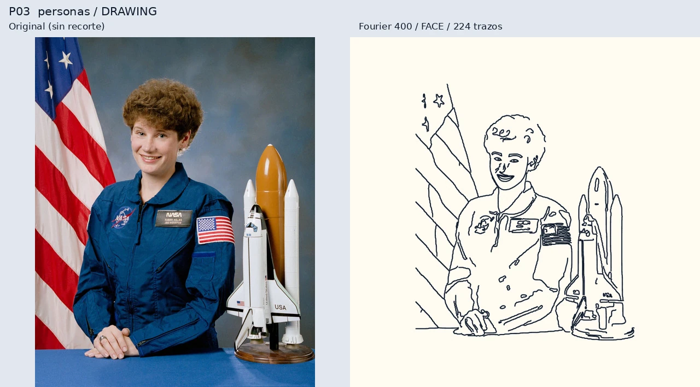](outputs-drawing/P03.png)

[Original](inputs/P03.jpg) · [PNG íntegro](outputs-drawing/P03.png) · [Fuente y licencia](https://commons.wikimedia.org/wiki/File:Susan_J._Helms_-_Official_portrait_of_astronaut_candidate.jpg)

## P04 · puntuación 2

Contorno facial, ojos, nariz, boca y cabello conservados. Líneas sobrantes en insignias y fondo.

[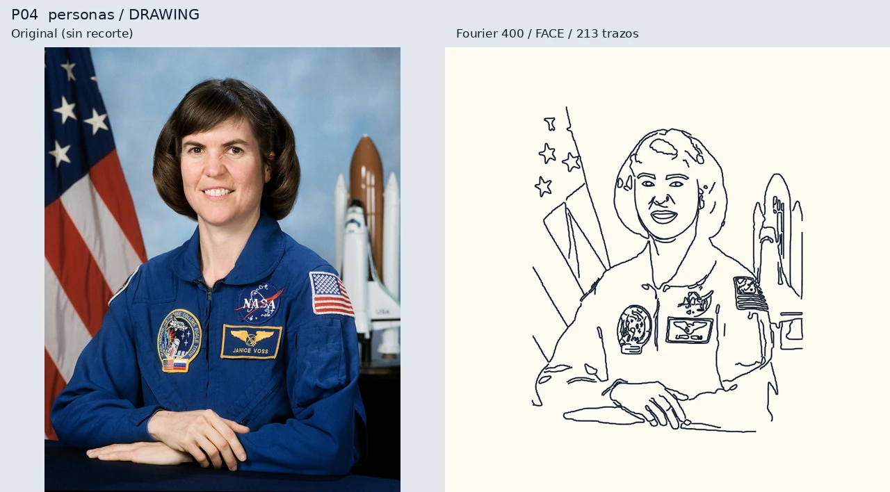](outputs-drawing/P04.png)

[Original](inputs/P04.jpg) · [PNG íntegro](outputs-drawing/P04.png) · [Fuente y licencia](https://commons.wikimedia.org/wiki/File:Janice_Voss.jpg)

## P05 · puntuación 2

Rostro, sonrisa y cabello largo reconocibles; nariz fragmentada y textura del cabello simplificada.

[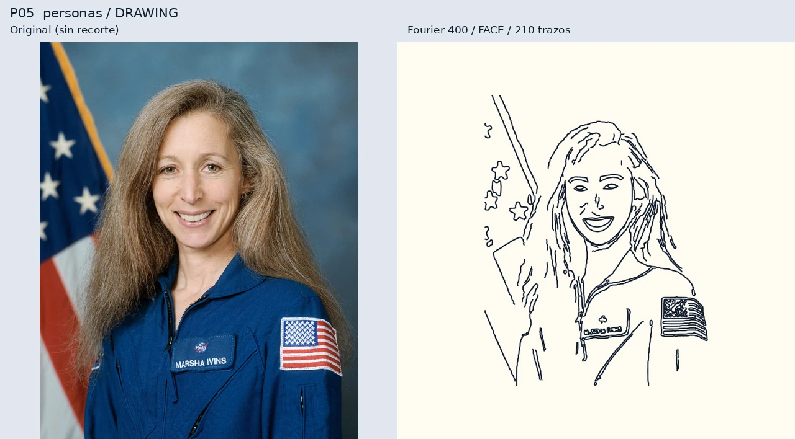](outputs-drawing/P05.png)

[Original](inputs/P05.jpg) · [PNG íntegro](outputs-drawing/P05.png) · [Fuente y licencia](https://commons.wikimedia.org/wiki/File:Marsha_Ivins.jpg)

## P06 · puntuación 2

Astronauta, casco y disposición de ojos, nariz y boca distinguibles; cabello y parte del traje pierden contorno.

[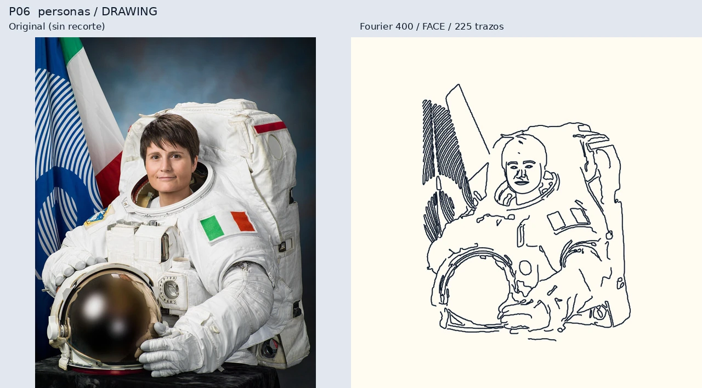](outputs-drawing/P06.png)

[Original](inputs/P06.jpg) · [PNG íntegro](outputs-drawing/P06.png) · [Fuente y licencia](https://commons.wikimedia.org/wiki/File:Samantha_Cristoforetti_official_portrait_in_an_EMU_spacesuit.jpg)

## P07 · puntuación 2

Persona sentada con maqueta, rostro y rasgos principales distinguibles; manos y ropa fragmentadas.

[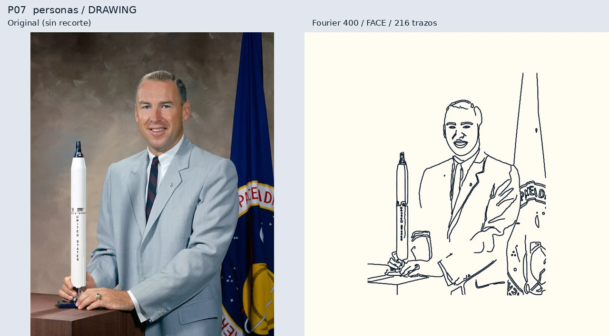](outputs-drawing/P07.png)

[Original](inputs/P07.jpg) · [PNG íntegro](outputs-drawing/P07.png) · [Fuente y licencia](https://commons.wikimedia.org/wiki/File:Jim_Lovell_official_1964_portrait.jpg)

## P08 · puntuación 2

Se conservan siete personas, su disposición y los rasgos faciales principales; cuerpos muy simplificados y fondo residual.

[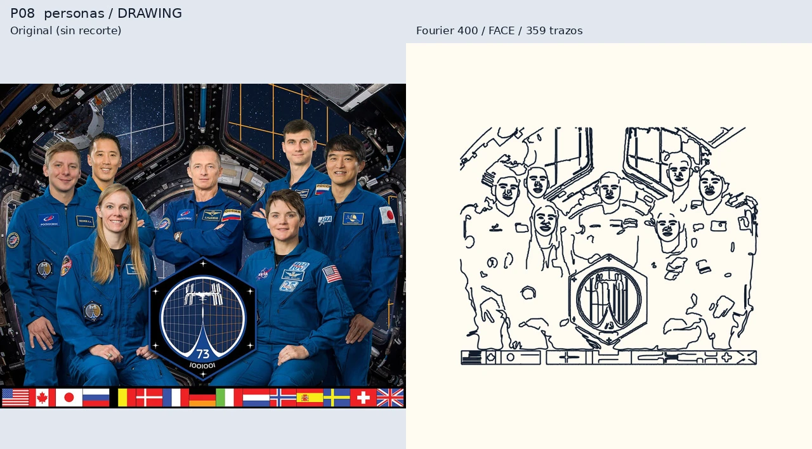](outputs-drawing/P08.png)

[Original](inputs/P08.jpg) · [PNG íntegro](outputs-drawing/P08.png) · [Fuente y licencia](https://commons.wikimedia.org/wiki/File:The_official_portrait_of_the_Expedition_73_crew_(iss073-s-002).jpg)

## P09 · puntuación 2

Dos personas enfrentadas distinguibles, con un ojo visible, nariz y boca por perfil; nariz y contorno de los perfiles deformados.

[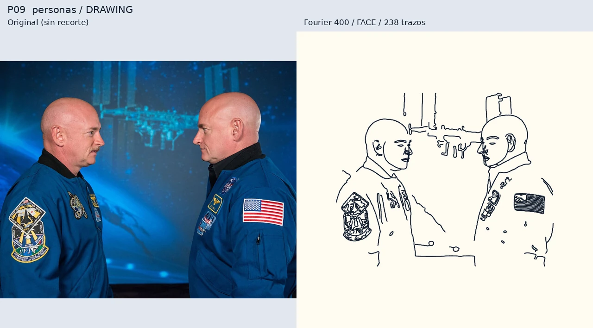](outputs-drawing/P09.png)

[Original](inputs/P09.jpg) · [PNG íntegro](outputs-drawing/P09.png) · [Fuente y licencia](https://commons.wikimedia.org/wiki/File:Mark_and_Scott_Kelly_at_the_Johnson_Space_Center,_Houston_Texas_-_profile.jpg)

## P10 · puntuación 0

Se conserva la cara pequeña, pero el cuerpo en sombra y la postura se pierden; las ventanas dominan una escena fragmentada.

[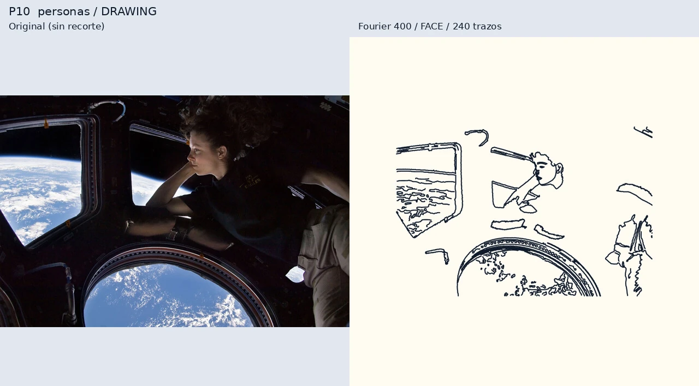](outputs-drawing/P10.png)

[Original](inputs/P10.jpg) · [PNG íntegro](outputs-drawing/P10.png) · [Fuente y licencia](https://commons.wikimedia.org/wiki/File:Tracy_Caldwell_Dyson_in_Cupola_ISS.jpg)

## M01 · puntuación 0

Perro confundido con ramas y suelo; se pierden gran parte del lomo, el contorno corporal y los rasgos de la cara.

[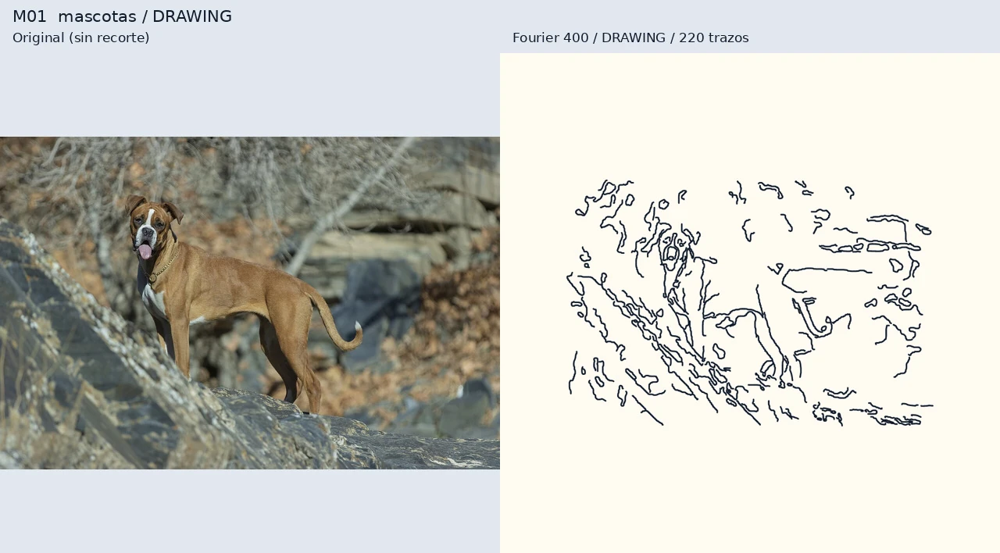](outputs-drawing/M01.png)

[Original](inputs/M01.jpg) · [PNG íntegro](outputs-drawing/M01.png) · [Fuente y licencia](https://commons.wikimedia.org/wiki/File:Boxer_(dog)_,_Iran_08.jpg)

## M02 · puntuación 0

Contorno de pelo y cuerpo parcial, pero ojos y hocico no quedan definidos; líneas del suelo compiten con el sujeto.

[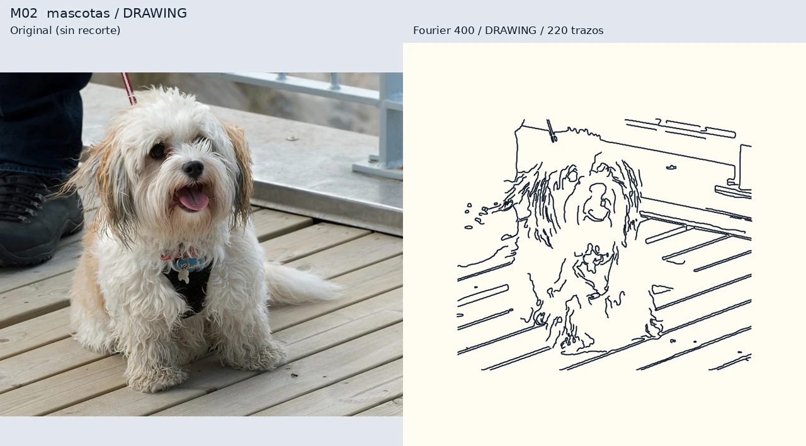](outputs-drawing/M02.png)

[Original](inputs/M02.jpg) · [PNG íntegro](outputs-drawing/M02.png) · [Fuente y licencia](https://commons.wikimedia.org/wiki/File:Dog_at_N%C3%B8rre_Vorup%C3%B8r_Strand.jpg)

## M03 · puntuación 0

Bozal parcialmente conservado, pero se pierden orejas y ojos del perro entre las ramas; no basta para reconocer claramente la cabeza.

[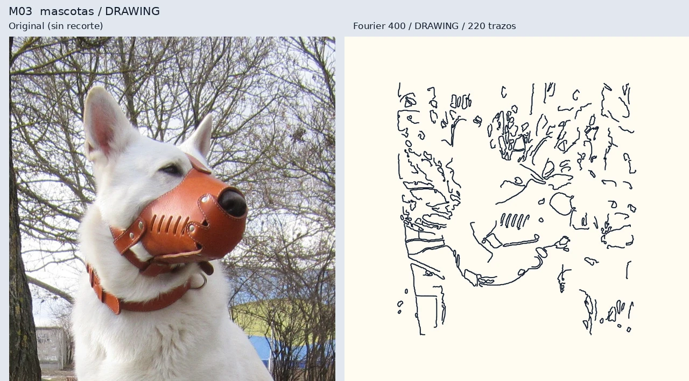](outputs-drawing/M03.png)

[Original](inputs/M03.jpg) · [PNG íntegro](outputs-drawing/M03.png) · [Fuente y licencia](https://commons.wikimedia.org/wiki/File:Dog_in_a_muzzle.jpg)

## M04 · puntuación 0

Animal pequeño con cola y patas parciales; forma de la cabeza, ojos y hocico ambiguos. El paisaje domina.

[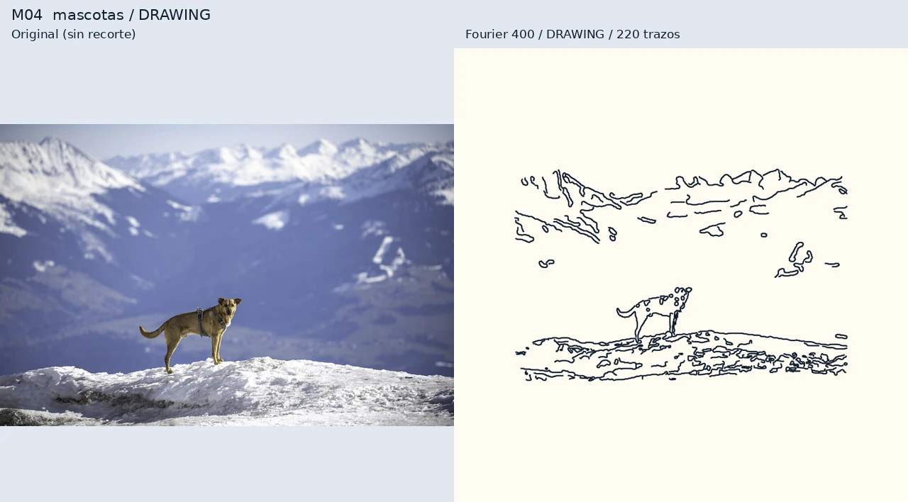](outputs-drawing/M04.png)

[Original](inputs/M04.jpg) · [PNG íntegro](outputs-drawing/M04.png) · [Fuente y licencia](https://commons.wikimedia.org/wiki/File:Mixed-breed_dogs_in_Serles.jpg)

## M05 · puntuación 0

Se distinguen cabeza y lengua, pero la zona de nariz/hocico queda vacía o deformada y no conserva sus rasgos principales. Revisado también a 1024 px.

[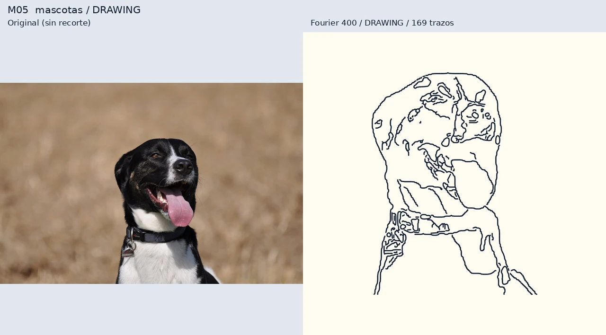](outputs-drawing/M05.png)

[Original](inputs/M05.jpg) · [PNG íntegro](outputs-drawing/M05.png) · [Fuente y licencia](https://commons.wikimedia.org/wiki/File:Panting-dog-No.3.jpg)

## M06 · puntuación 2

Gato reconocible con orejas, ambos ojos, nariz y boca en su posición; contorno del cuerpo simplificado y líneas sobrantes.

[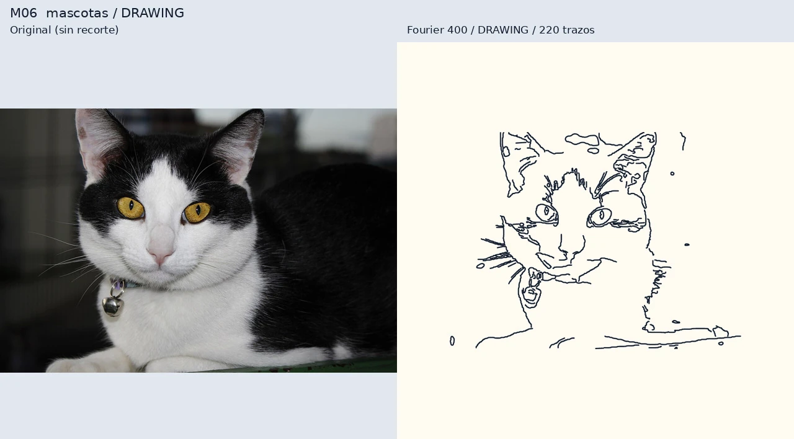](outputs-drawing/M06.png)

[Original](inputs/M06.jpg) · [PNG íntegro](outputs-drawing/M06.png) · [Fuente y licencia](https://commons.wikimedia.org/wiki/File:Closeup_photo_of_a_cat.jpg)

## M07 · puntuación 0

Oreja y cabeza inclinada parciales, pero nariz y ojos cerrados se mezclan con trazos de pelo; cuerpo casi perdido. Revisado también a 1024 px.

[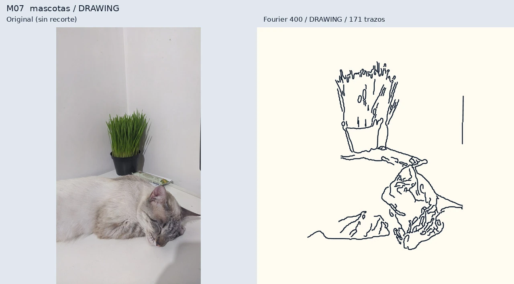](outputs-drawing/M07.png)

[Original](inputs/M07.jpg) · [PNG íntegro](outputs-drawing/M07.png) · [Fuente y licencia](https://commons.wikimedia.org/wiki/File:Cat_-_Moomin.jpg)

## M08 · puntuación 0

Orejas y toalla presentes, pero cara, ojos y nariz quedan incompletos; el relleno visual de la toalla domina.

[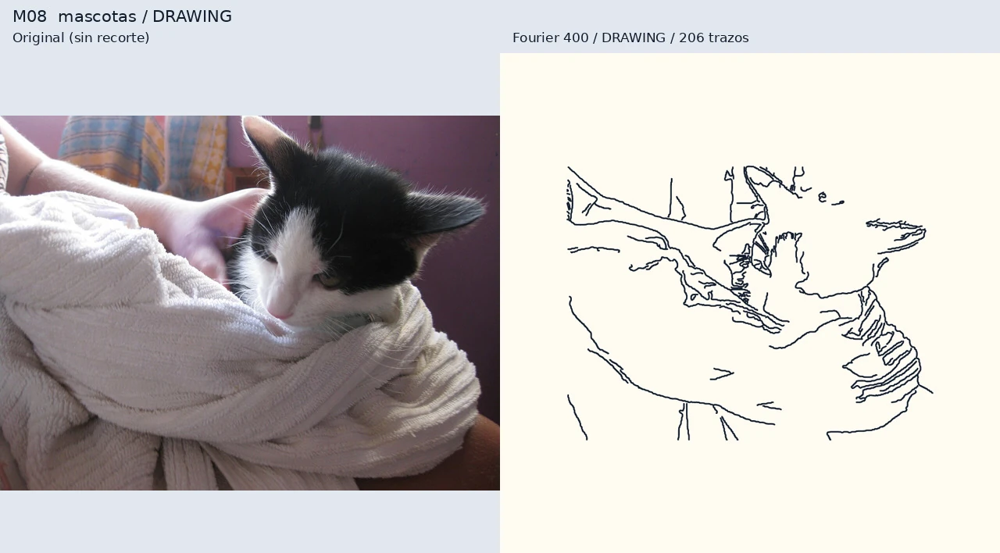](outputs-drawing/M08.png)

[Original](inputs/M08.jpg) · [PNG íntegro](outputs-drawing/M08.png) · [Fuente y licencia](https://commons.wikimedia.org/wiki/File:Cat_in_towel.jpg)

## M09 · puntuación 2

Gato tumbado reconocible con dos ojos, nariz, hocico y orejas; pata y cuerpo incompletos. Revisado también a 1024 px.

[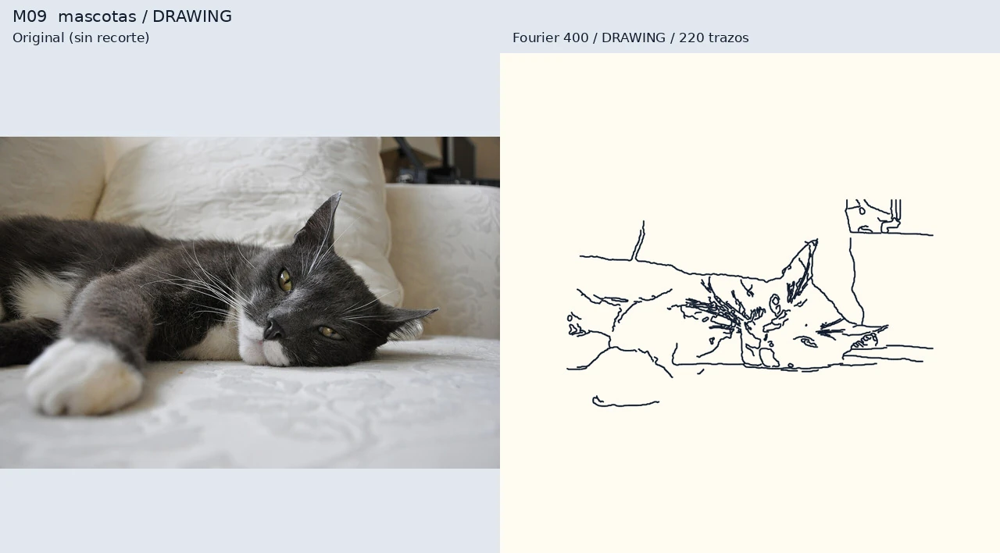](outputs-drawing/M09.png)

[Original](inputs/M09.jpg) · [PNG íntegro](outputs-drawing/M09.png) · [Fuente y licencia](https://commons.wikimedia.org/wiki/File:Cat-on-couch.jpg)

## M10 · puntuación 0

El gato del jardín prácticamente desaparece; se conservan escaleras y macetas, sin rasgos suficientes del sujeto.

[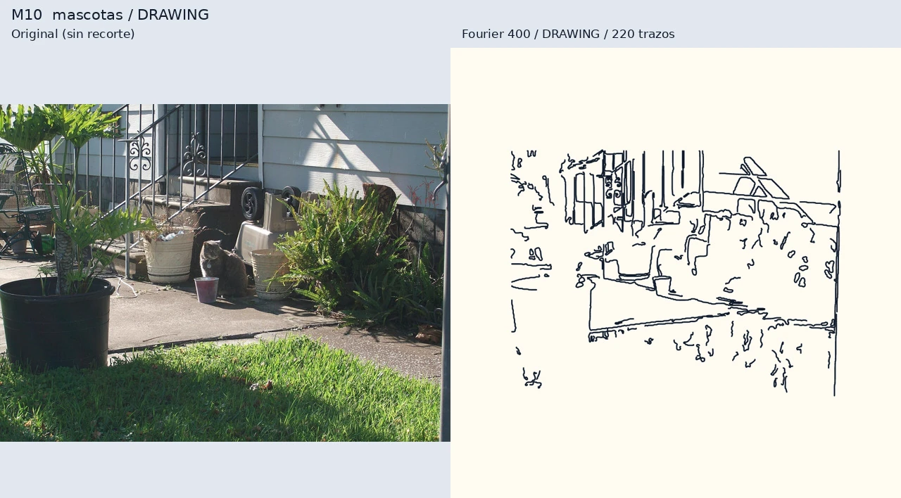](outputs-drawing/M10.png)

[Original](inputs/M10.jpg) · [PNG íntegro](outputs-drawing/M10.png) · [Fuente y licencia](https://commons.wikimedia.org/wiki/File:Cat_in_backyard.jpg)

## O01 · puntuación 2

Taza distinguible por borde circular, asa y abertura; aparece un fragmento de sombra sobrante.

[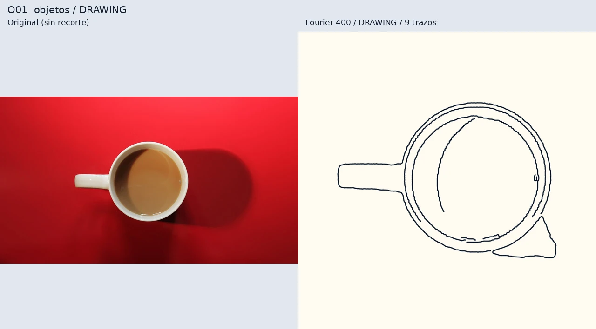](outputs-drawing/O01.png)

[Original](inputs/O01.jpg) · [PNG íntegro](outputs-drawing/O01.png) · [Fuente y licencia](https://commons.wikimedia.org/wiki/File:Coffee_cup_seen_from_above.jpg)

## O02 · puntuación 2

Bicicleta de madera distinguible por ruedas, cuadro, transmisión y soportes; líneas sobrantes del fondo y del cartel.

[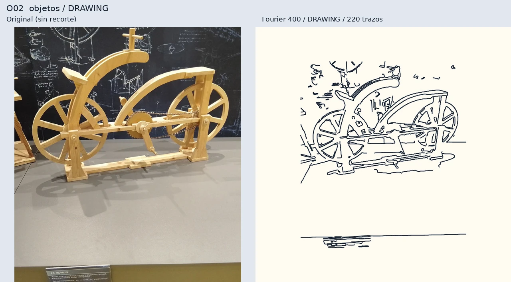](outputs-drawing/O02.png)

[Original](inputs/O02.jpg) · [PNG íntegro](outputs-drawing/O02.png) · [Fuente y licencia](https://commons.wikimedia.org/wiki/File:Leonardo%27s_bicycle.jpg)

## O03 · puntuación 2

Equipo fotográfico distinguible por gran objetivo cilíndrico, cámara y trípode; persona y entorno añaden ruido.

[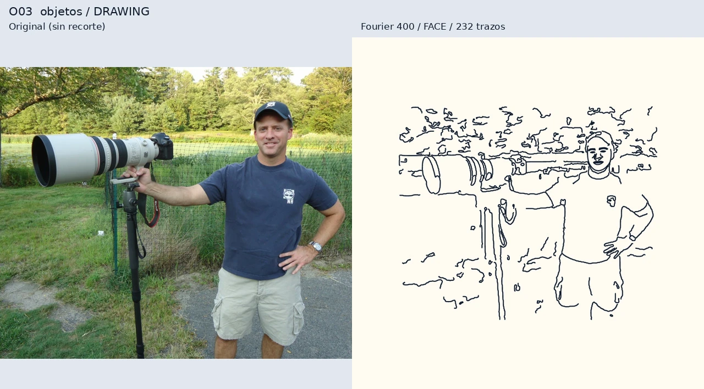](outputs-drawing/O03.png)

[Original](inputs/O03.jpg) · [PNG íntegro](outputs-drawing/O03.png) · [Fuente y licencia](https://commons.wikimedia.org/wiki/File:Large_photographic_lens_with_a_camera.jpg)

## O04 · puntuación 2

Silla distinguible por respaldo, brazos, asiento y base; pequeñas tallas se pierden y aparecen líneas de textura.

[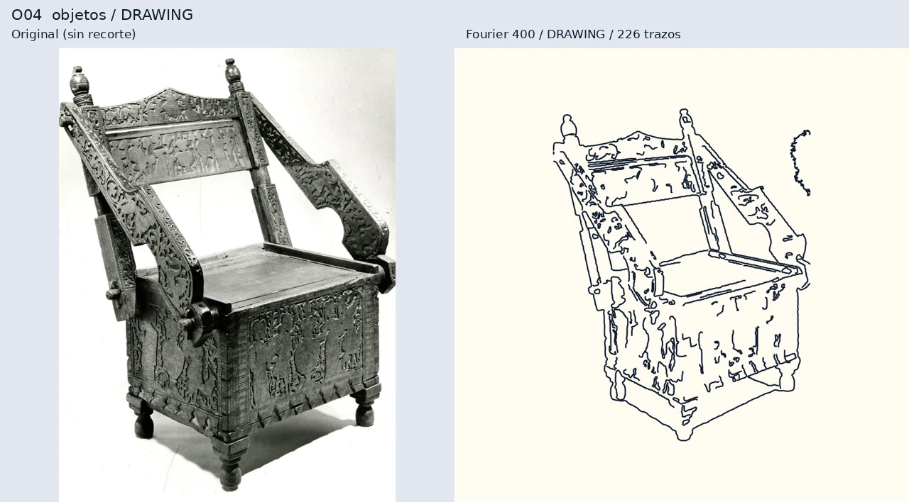](outputs-drawing/O04.png)

[Original](inputs/O04.jpg) · [PNG íntegro](outputs-drawing/O04.png) · [Fuente y licencia](https://commons.wikimedia.org/wiki/File:Arm_Chair_MET_cds164235.jpg)

## O05 · puntuación 2

Silla de rejilla distinguible por respaldo, brazos y base con ruedas; parte del asiento queda incompleta.

[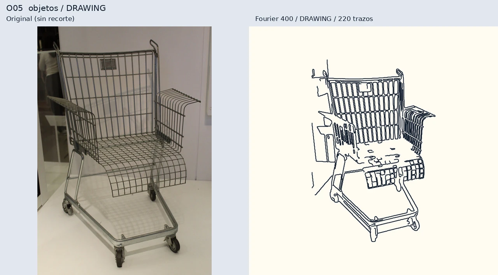](outputs-drawing/O05.png)

[Original](inputs/O05.jpg) · [PNG íntegro](outputs-drawing/O05.png) · [Fuente y licencia](https://commons.wikimedia.org/wiki/File:Consumer%27s_Rest_chair,_V%26A_Museum_01.jpg)

## O06 · puntuación 2

Insecto distinguible por antenas, patas, alas y abdomen segmentado; bordes duplicados.

[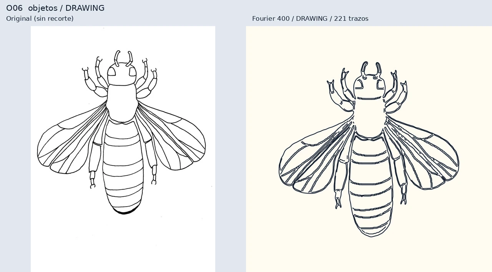](outputs-drawing/O06.png)

[Original](inputs/O06.jpg) · [PNG íntegro](outputs-drawing/O06.png) · [Fuente y licencia](https://commons.wikimedia.org/wiki/File:Honey_Bee_Line_Drawing.jpg)

## O07 · puntuación 2

León alado distinguible por melena, alas, cuatro patas y cola; cara y pelaje pierden detalle.

[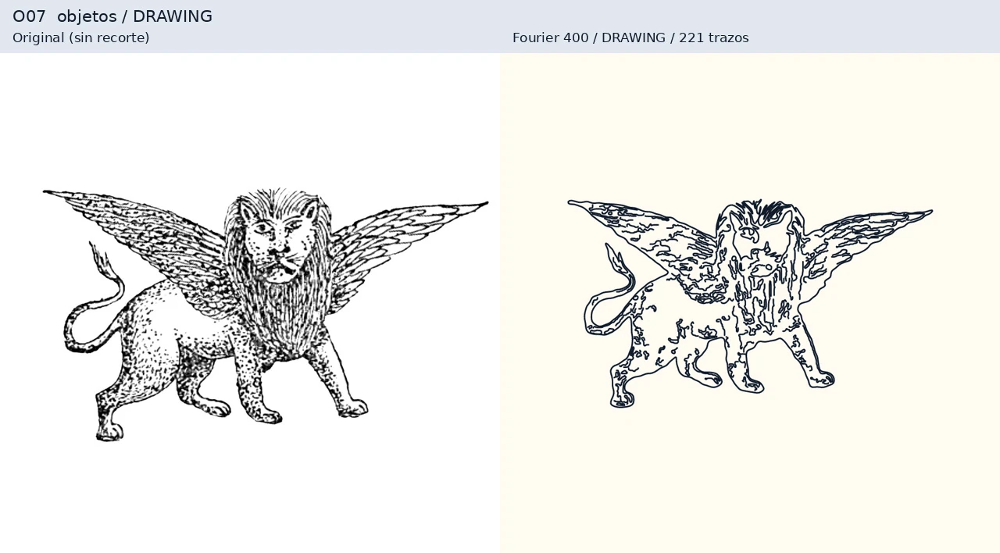](outputs-drawing/O07.png)

[Original](inputs/O07.jpg) · [PNG íntegro](outputs-drawing/O07.png) · [Fuente y licencia](https://commons.wikimedia.org/wiki/File:A_line_drawing_of_a_lion_with_wings_(public_domain).jpg)

## O08 · puntuación 2

Ramo distinguible por flores, hojas y tallos atados; pétalos interiores fragmentados.

[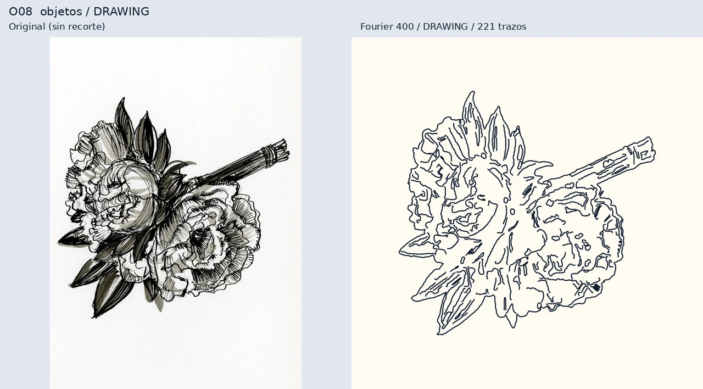](outputs-drawing/O08.png)

[Original](inputs/O08.jpg) · [PNG íntegro](outputs-drawing/O08.png) · [Fuente y licencia](https://commons.wikimedia.org/wiki/File:Bouquet_(flowers).jpg)

## O09 · puntuación 2

Bicicleta distinguible por ruedas, cuadro, sillín, manillar y transmisión; radios duplicados y algunos bordes abiertos.

[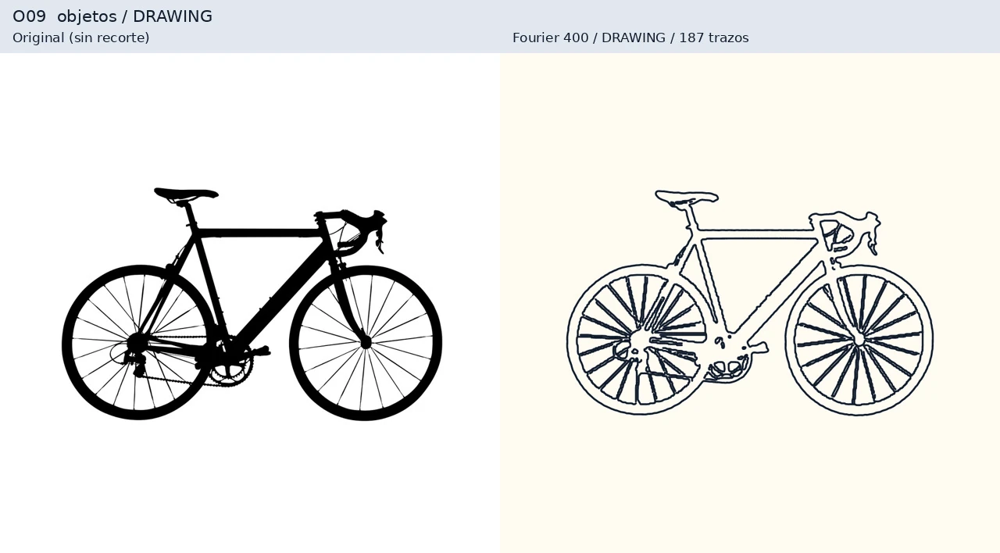](outputs-drawing/O09.png)

[Original](inputs/O09.jpg) · [PNG íntegro](outputs-drawing/O09.png) · [Fuente y licencia](https://commons.wikimedia.org/wiki/File:Bicycle_(453586)_-_The_Noun_Project.svg)

## O10 · puntuación 2

Cámara distinguible por cuerpo, objetivo circular y controles; contorno abierto junto al borde original y exceso de anillos.

[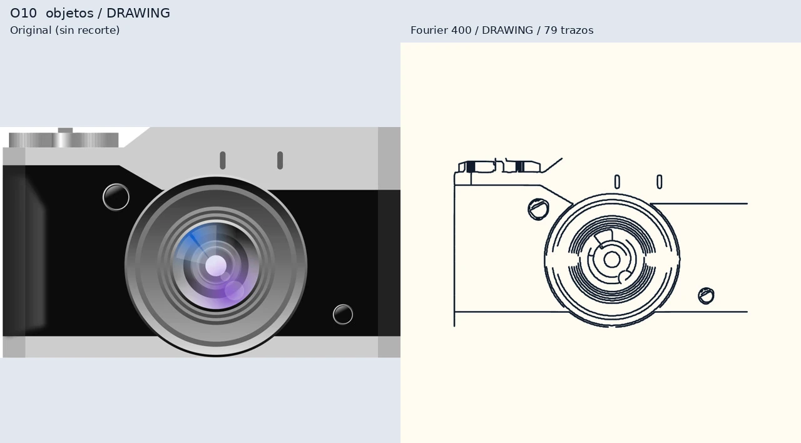](outputs-drawing/O10.png)

[Original](inputs/O10.jpg) · [PNG íntegro](outputs-drawing/O10.png) · [Fuente y licencia](https://commons.wikimedia.org/wiki/File:Camera_by_donchico.svg)

