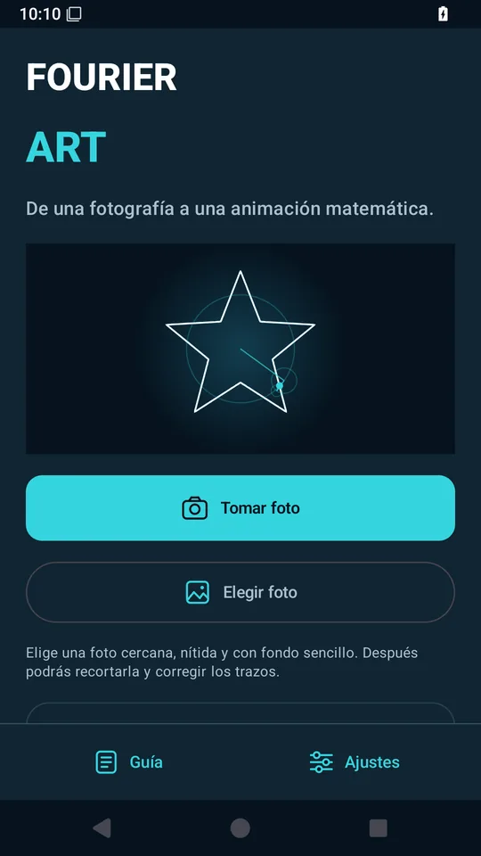
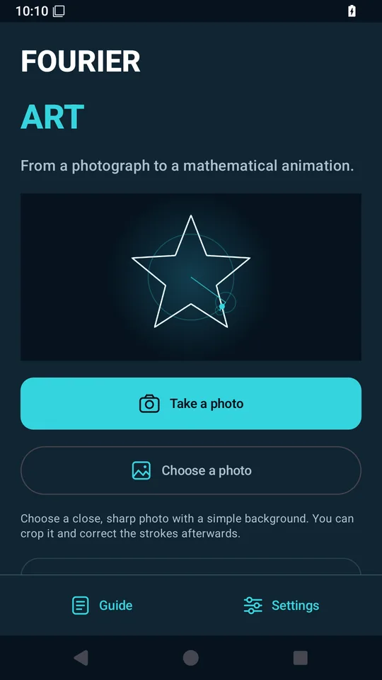
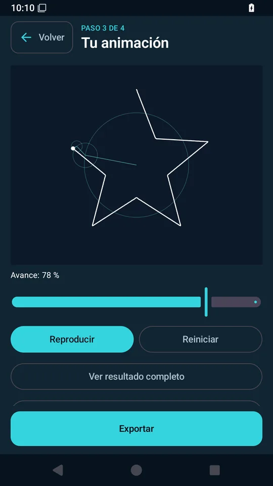
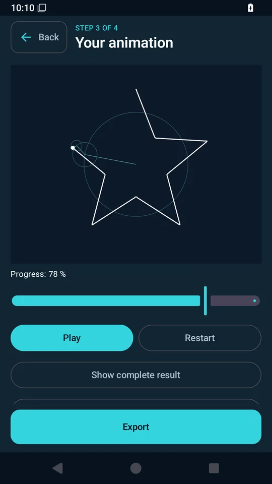
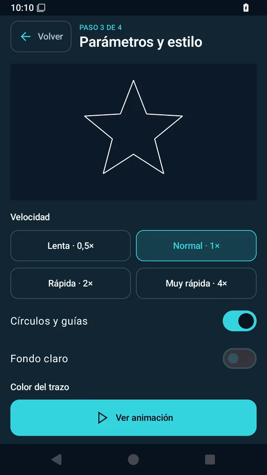
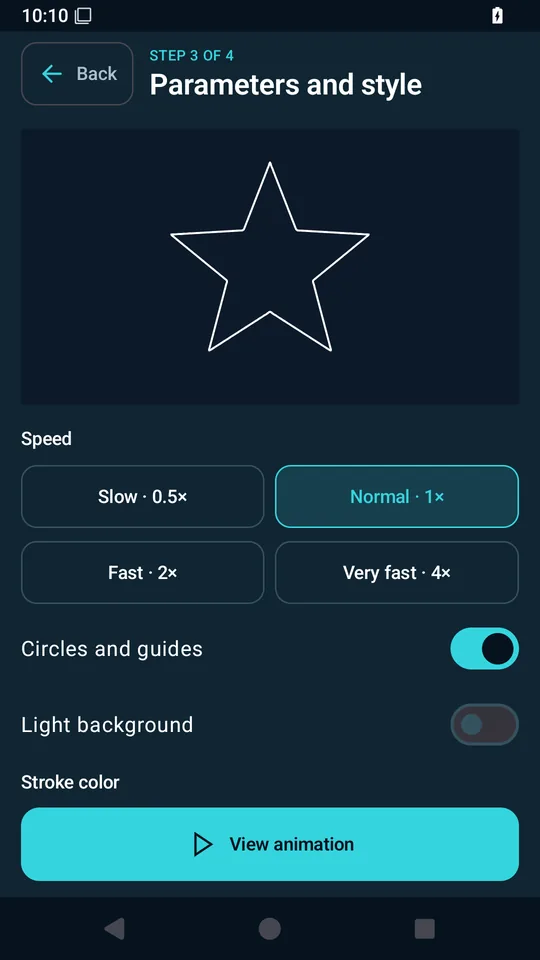
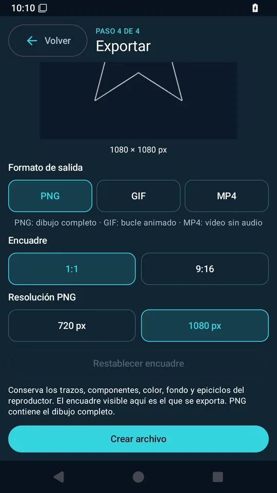
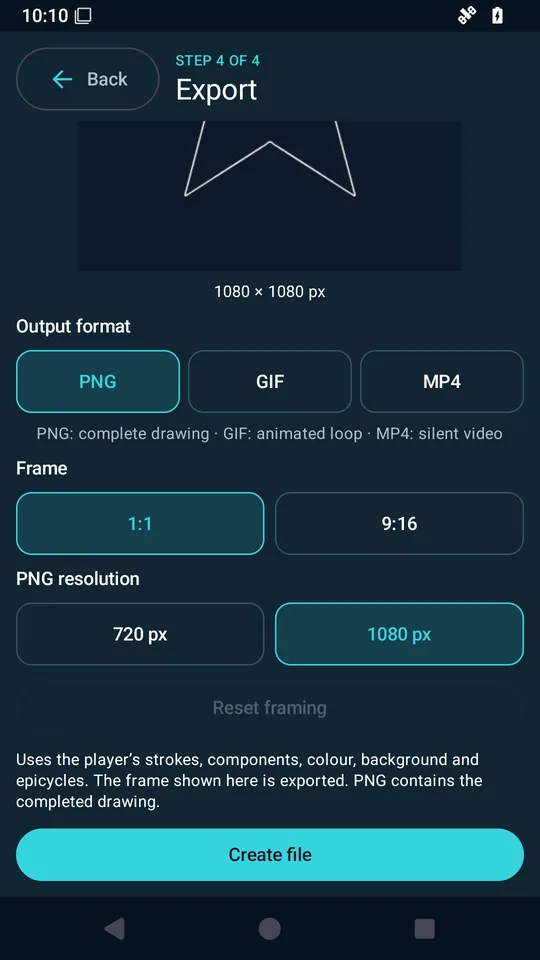

# Capturas reales — FOURIER ART 0.13.0

Capturadas en Android 15 desde un APK release derivado del AAB, firmado solo para la prueba con el certificado temporal de CI. [Ejecución correcta](https://github.com/carlossan1993/fourier-art-android/actions/runs/39552473338). La prueba también verifica la política offline en ambos idiomas y su conservación al recrear la actividad.

Las vistas siguientes son WebP reducidos a 540×960 para revisión. Los PNG RGB completos de 1080×1920 están en el ZIP de entrega y son los que se deben usar para Play. [Hashes y procedencia](screenshot-manifest.json). Sin montajes ni resultados fotográficos inventados; la animación muestra la demostración de estrella incluida en la app.

| Pantalla | Español | English |
| --- | --- | --- |
| Inicio |  |  |
| Animación |  |  |
| Controles |  |  |
| Exportación |  |  |

La entrega incluye además dos capturas por idioma de la política y de la información de Google. Son evidencia de privacidad; para la ficha se sugieren las cuatro vistas anteriores.
